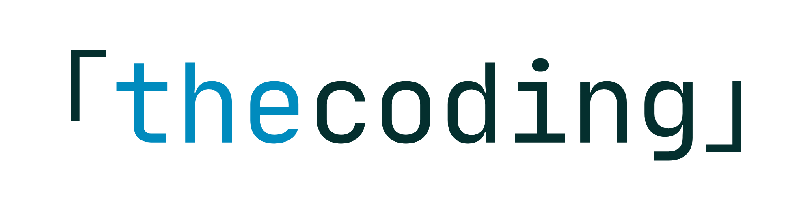
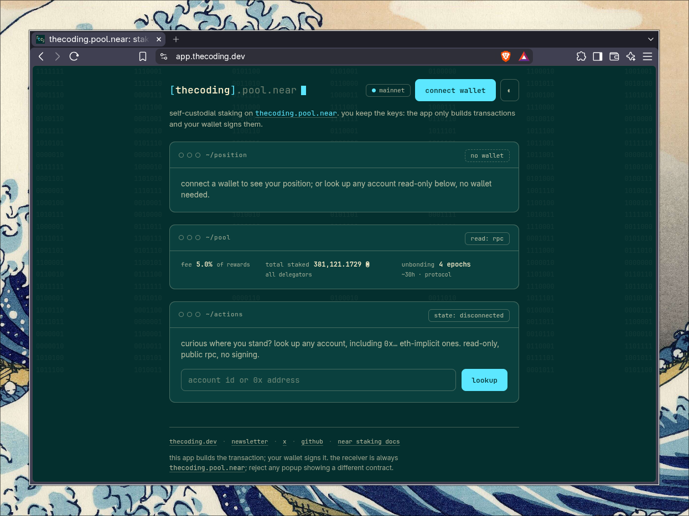

<p align="center">
  <picture>
    <source media="(prefers-color-scheme: dark)" srcset="public/logo-dark.png">
    
  </picture>
</p>

# thecoding.pool.near

Self-custodial interface to stake, unstake, and withdraw NEAR on
[`thecoding.pool.near`](https://nearblocks.io/address/thecoding.pool.near).

You connect a NEAR wallet and sign each action yourself. This app never
asks for a seed phrase, never stores a private key, and never submits a
pool call from a server account.

[](LICENSE)
[](https://app.thecoding.dev)
[](package.json)

**Use it:** [app.thecoding.dev](https://app.thecoding.dev) — no install, connect
a wallet, stake.

**v2:** connect → stake → unstake → withdraw, same custody and path,
now with a position-first interface.

<p align="center">
  
</p>

---

## How custody works

On NEAR, `deposit_and_stake`, `unstake`, and `withdraw` credit the
**predecessor** — the account that signed the transaction.

If a backend sent those calls, the stake would sit on the backend
account, not yours. That would be custody. This app does not do that.

```
your wallet  ── signs ──►  FunctionCall  ──►  thecoding.pool.near
                               ▲
               this app only builds the call
               and reads public view methods
```

You can confirm the receiver and method in your wallet before you
approve. The builders live in [`src/lib/pool.ts`](src/lib/pool.ts).

---

## Features

- **Six pool writes**, all signed by your wallet: stake, restake,
  unstake, unstake-all, withdraw, withdraw-all.
- **Position view**: staked, unstaking, and liquid balances plus the
  pool fee, APY (previous epoch's reward, annualized, net of
  fee), and total pool stake, read live from the contract and the
  RPC validator set.
- **Data view (`app.thecoding.dev/#/data`)**: node health (epoch
  duties, stake rollover, kickout/slash record), network staking
  totals, per-epoch history charts, and protocol issuance parameters
  with the [HSP-029](https://gov.houseofstake.org/proposals/29)
  framing. All read-only, all live.
- **FAQ**: the three beginner-first questions (custody, unbonding and
  withdrawal, rewards) answered below the actions panel.
- **Contract-gated withdrawals**: the Withdraw control follows the
  pool's own withdrawability report, not a clock in the browser.
- **Wallet popup as the final gate**: receiver, method, and deposit
  are visible in your wallet before every signature.
- **Human-friendly amounts**: accepts `1.5` and `1,5` as decimal
  input; every transaction links to
  [NearBlocks](https://nearblocks.io) for confirmation.
- **Light and dark mode**, no tracking, static site.

---

## Quick start

**Use hosted** (mainnet, real funds): open
[app.thecoding.dev](https://app.thecoding.dev), connect a NEAR wallet, stake.

**Run from source:**

```bash
npm install
npm run dev      # http://localhost:5173
npm test
npm run build
```

Requires Node 24.x on Vercel (`engines` in `package.json`; the build
image offers only 24.x/22.x majors and rolls security patches
automatically). Local dev pins 24.22.1 via [`.nvmrc`](.nvmrc). No
environment variables are needed:
RPC endpoints are hardcoded in [`src/config.ts`](src/config.ts)
(FastNEAR first, official mainnet RPC as fallback), and no `VITE_*`
values may enter the bundle (see
[ADR-02](docs/adr/ADR-02.md)).

---

## Pool contract

- Network: **NEAR mainnet**
- Contract: **`thecoding.pool.near`** (standard staking-pool)
- Amounts in the UI: NEAR. Amounts on-chain: yoctoNEAR
  (1 NEAR = 10²⁴ yoctoNEAR)

### Writes (your wallet signs)

| Action | Method | Attached deposit | Arguments |
| --- | --- | --- | --- |
| Stake (new funds) | `deposit_and_stake` | the stake amount | `{}` |
| Restake (from unstaked bucket) | `stake` | none | `{ "amount": "<yoctoNEAR>" }` |
| Unstake an amount | `unstake` | none | `{ "amount": "<yoctoNEAR>" }` |
| Unstake all | `unstake_all` | none | `{}` |
| Withdraw an amount | `withdraw` | none | `{ "amount": "<yoctoNEAR>" }` |
| Withdraw all | `withdraw_all` | none | `{}` |

Prepaid gas on each write: 50 TGas. Unstake and withdraw never attach
NEAR. The app will not submit an amount of `0`.

### Reads (no signature)

Primary: `get_account` — staked balance, unstaked balance, and when
unstaked funds become withdrawable.

Also used: `is_account_unstaked_balance_available`,
`get_reward_fee_fraction`, `get_total_staked_balance`.

### Unbonding

Unstaking does not return NEAR immediately. The pool requires **4 epochs
(~7.5 hours each)** before a withdraw is allowed.

The Withdraw control follows the contract
(`is_account_unstaked_balance_available` / account withdrawability),
not a clock in the browser. Copy in the UI is an estimate; the
contract is the gate.

---

## What you should see in the wallet popup

- **Receiver:** `thecoding.pool.near`
- **Method:** one of the six writes above
- **Deposit:** only on `deposit_and_stake`, equal to the amount you typed
- **No other receivers** in that transaction

If a popup shows a different contract, a transfer to an unknown
account, or a method that is not in the table, reject it.

---

## Safety rules the UI enforces

- Amount must be greater than zero and within the available balance.
- Stake leaves at least **0.05 NEAR** liquid on the wallet so later
  transactions can pay gas.
- Withdraw stays disabled until the pool reports the unstaked balance
  as available.
- Decimal input accepts both `1.5` and `1,5`.

This software is MIT-licensed and provided as-is. Read
[`LICENSE`](LICENSE). Staking has protocol risk (validator performance,
unbonding delay, smart-contract risk of the official pool). This UI
does not change those.

---

## Security posture

Detailed in [ADR-02](docs/adr/ADR-02.md); in short:

- Key material never enters the app's trust boundary: no browser-held
  keys, no seed phrases, no credentials in web storage.
- Static-only hosting. No serverless functions in any path, read or
  write.
- A scoped CSP (wallet-sandbox compatible) closes plugin, base-tag,
  and form-action vectors. The wallet popup remains the final gate.

---

## Data view and sources

`app.thecoding.dev/#/data` is read-only and static, like the rest of
the app ([ADR-04](docs/adr/ADR-04.md)):

- **RPC reads** (same origins as pool reads,
  [`src/config.ts`](src/config.ts)): the `validators` method for the
  epoch set, duties, stakes, kickouts, and the previous epoch's
  reward; `EXPERIMENTAL_protocol_config` for live protocol parameters
  (epoch length, issuance cap).
- **Pool contract reads**: unchanged (`get_reward_fee_fraction`,
  `get_total_staked_balance`).
- **NearBlocks public stats** (`api.nearblocks.io`, no key): supply
  and nodes-online figures; failure degrades quietly to RPC-only
  values.
- **Epoch history** (`public/data/epochs.json`): collected by
  [`scripts/data-snapshot.mjs`](scripts/data-snapshot.mjs) 4x/24h
  (GitHub Action; the rolling PR is auto-merged by the workflow,
  [ADR-05](docs/adr/ADR-05.md)), served same-origin as build-time
  static data. No server ever joins the staking path.

Every estimate is labeled (`est`): the epoch APY derives its base
stake from the current total minus the previous epoch's reward, and
the epoch length is a protocol estimate; the contract and the chain
config are the sources of truth.

---

## Stack

| Layer | Choice |
| --- | --- |
| UI | Vite + React + TypeScript + Tailwind CSS |
| Wallet | [NEAR Connect](https://docs.near.org/tools/near-connect) (`@hot-labs/near-connect`, `near-connect-hooks`) |
| Tests | Vitest (123 tests across `src/lib` and `src/hooks`) |
| Host | Static site (Vercel) — no server in the staking path |
| License | MIT |

---

## Repository layout

```text
src/
├── App.tsx                  # NearProvider (mainnet) + hash routing + shell
├── config.ts                # pool id, RPC endpoints, gas, buffers, hsp-029
├── lib/
│   ├── near.ts              # NEAR ↔ yoctoNEAR, decimal parsing, formatting
│   ├── pool.ts              # the six write builders + contract reads
│   ├── poolRead.ts          # public view calls (RPC fallback walk)
│   ├── metrics.ts           # apy, productivity, ratios (bigint-safe)
│   ├── networkRead.ts       # validator set + protocol config + nearblocks
│   ├── epochHistory.ts      # public/data/epochs.json types + loader
│   ├── chart.ts             # svg chart math
│   └── *.test.ts            # vitest, colocated
├── hooks/
│   ├── usePoolAccount.ts    # balances, fee, max stake (0.05 NEAR buffer)
│   ├── useTx.ts             # sign + send, pending/error/success states
│   ├── useHashRoute.ts      # #/data hash routing
│   └── *.test.ts
└── components/
    ├── PositionPanel.tsx    # ~/position: staked / unstaking / liquid
    ├── PoolStrip.tsx        # ~/pool: fee, total staked, apy, unbonding
    ├── JourneyPanel.tsx     # ~/actions: availability-driven writes
    ├── FaqPanel.tsx         # ~/faq: custody, unbonding, rewards
    ├── DataView.tsx          # #/data view
    ├── data/                # ~/node, ~/network, ~/epochs, ~/issuance panels
    ├── ui/                  # panel chrome, chips, buttons, charts
    └── TxToast.tsx          # toast with NearBlocks transaction link
scripts/
└── data-snapshot.mjs        # epoch snapshot writer (zero deps, CI + local)
public/data/
└── epochs.json             # build-time epoch history (ADR-04 §4)
docs/
└── adr/                     # architecture decision records
```

---

## Documentation

- [`docs/`](docs/README.md) — engineering record and decisions
- [ADR-01](docs/adr/ADR-01.md) — self-custodial v1 design
- [ADR-02](docs/adr/ADR-02.md) — security posture
- [ADR-03](docs/adr/ADR-03.md) — visual system for the v2 shell
- [ADR-04](docs/adr/ADR-04.md) — metrics, FAQ, and the `#/data` view
- [ADR-05](docs/adr/ADR-05.md) — automatic snapshot publishing and cadence

---

## Contributing

See [`CONTRIBUTING.md`](CONTRIBUTING.md). Changes that touch custody,
contract calls, or networks require a new
[ADR](docs/adr/README.md) in the same change set.

---

## Out of scope

- A server that stakes, unstakes, or withdraws for you
- Cross-chain wallets and NEAR Intents
- Delegator points
- Backend-keyed validator operations (the `#/data` view is
  read-only and static; the epoch history is collected by a
  scheduled workflow, not a server)

None of these change v1 custody: your key still signs the pool call.

---

## License

[MIT](LICENSE)
